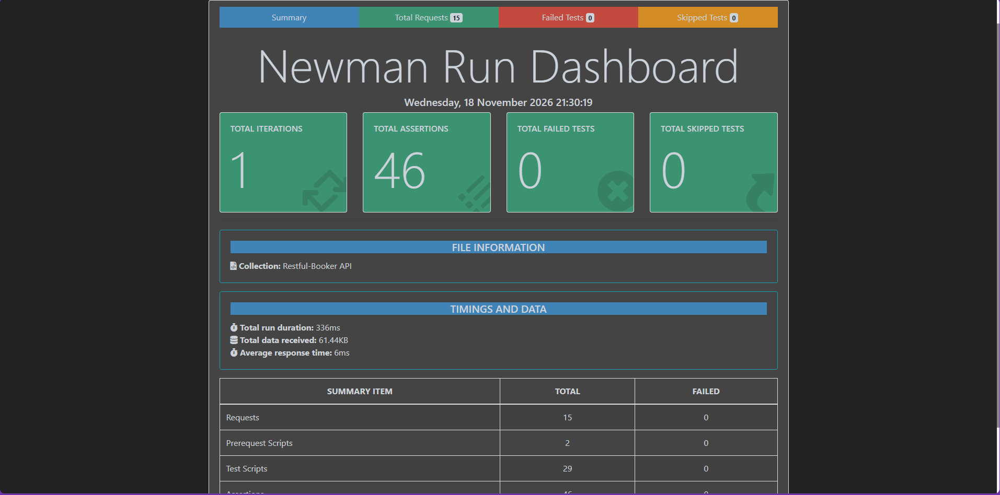

# Pruebas de API con Postman y Newman — Restful-Booker


Colección de pruebas de API sobre [Restful-Booker](https://restful-booker.herokuapp.com/apidoc/index.html), una API de práctica con autenticación y errores intencionales. Se ejecuta con **Newman** en **GitHub Actions** y genera un reporte HTML.

## Qué se prueba

| Área | Cobertura |
|---|---|
| Health | Disponibilidad de la API (`/ping`) |
| Auth | Creación de token |
| Booking | Crear, consultar, listar, actualizar y borrar reservas |
| Negativos | ID inexistente, acciones sin token o con token inválido, body incompleto |

## Qué se valida

- Códigos de estado y tiempos de respuesta.
- Estructura de la respuesta (esquema JSON) y tipos de datos.
- Que los datos devueltos coincidan con los enviados.
- Encadenamiento de requests con variables (`token`, `bookingId`).
- Datos dinámicos generados en cada ejecución.

## Estructura

```text
├── .github/workflows/api-tests.yml
├── collections/   # Colección de Postman exportada
├── docs/          # Documentación e imágenes (ej. reporte-newman.png)
└── package.json
```

## Cómo ejecutarlo

Con Newman:

```bash
npm install
npm test
```

## Reporte



El reporte queda en `reports/newman-report.html`.

## Postman

Con Postman: importa `collections/restful-booker.postman_collection.json` y ejecútala con el Runner.

## CI/CD

En cada push o pull request a `main` se ejecuta la colección y el reporte HTML se guarda como artefacto del workflow.

## Hallazgos (Bugs y Comportamientos Inesperados)

Durante la ejecución de los casos de prueba negativos, se detectaron los siguientes comportamientos por parte de la API que difieren de las buenas prácticas de diseño REST:

| Endpoint | Caso de Prueba | Comportamiento Actual (Bug) | Comportamiento Esperado |
| :--- | :--- | :--- | :--- |
| `POST /auth` | Login con credenciales incorrectas | Devuelve un código **`200 OK`** (éxito), pero en el cuerpo incluye `{"reason": "Bad credentials"}`. | **`401 Unauthorized`**. Devolver un 200 ante un fallo de autenticación es un anti-patrón que obliga al cliente a leer el body para saber si falló. |
| `POST /booking` | Creación de reserva omitiendo un campo obligatorio (`lastname`) | Devuelve un código **`500 Internal Server Error`**. | **`400 Bad Request`** o **`422 Unprocessable Entity`**. La API no está validando la ausencia de campos y rompe el servidor en lugar de dar un error controlado. |

*Nota: Los scripts de Postman para estos casos están configurados para validar el comportamiento actual (esperando el 200 y el 500 respectivamente) para documentar el estado real de la API.*

## Autor

Yair Uriel García González